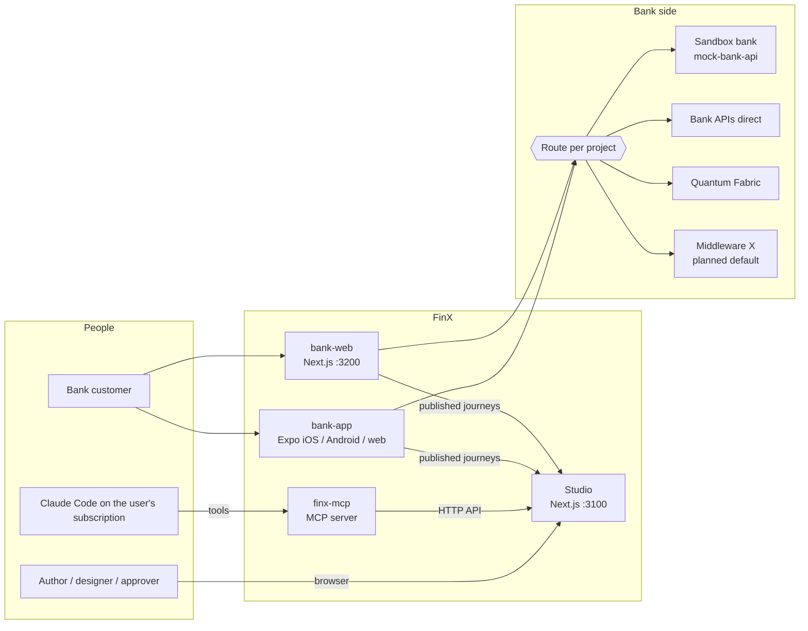
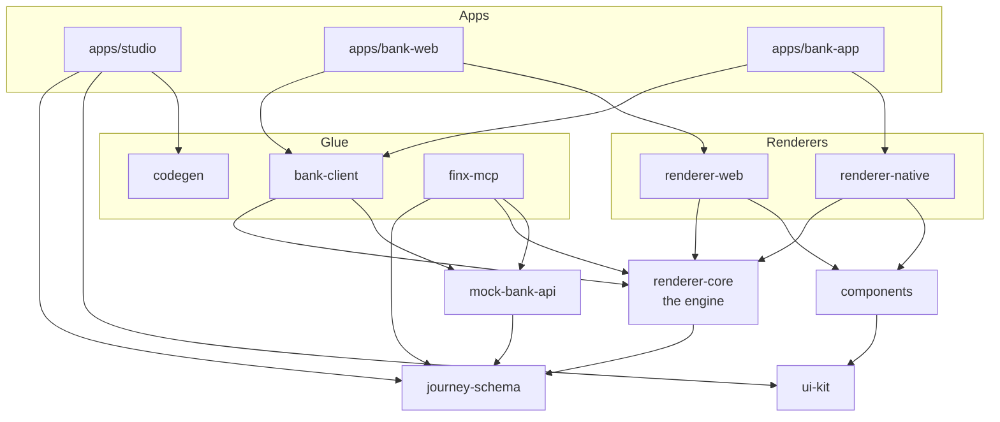
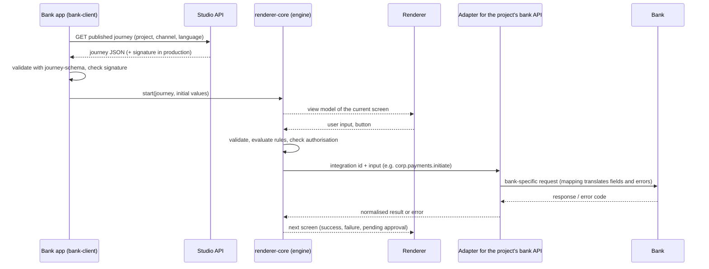
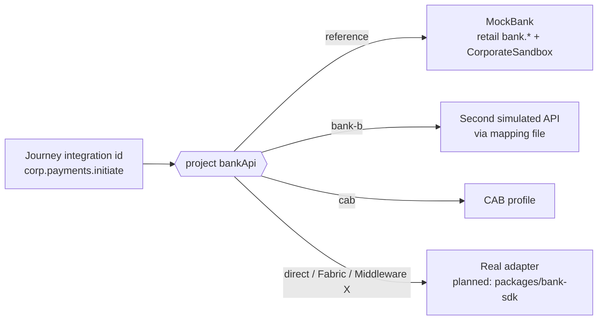
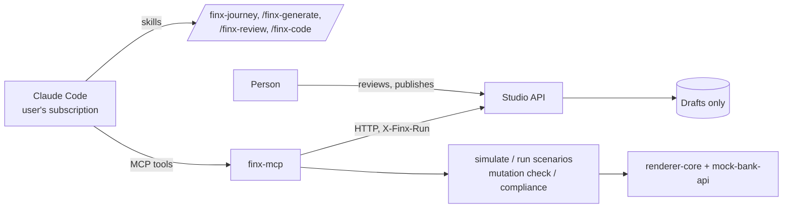

# FinX Studio: technical architecture

This is the long form of [ARCHITECTURE.md](../ARCHITECTURE.md). It says what the parts are, how they depend on each other, what runs where, where data lives, and what is built versus planned. Decisions that are expensive to reverse are in [docs/adr](adr/README.md).

Status marks used below: **built** (in `develop`), **in PR** (open pull request), **planned** (agreed direction, no code yet).

## 1. What the system is

FinX Studio is a platform for producing digital banking apps without writing app code per bank. A person (or Claude Code, drafting for them) describes a **journey** (a banking flow such as "pay a bill"). Studio stores it as validated JSON. Bank apps on iOS, Android and web download the published journey and run it with a shared engine, calling the bank through a typed adapter.

Three ideas carry the design:

1. **A journey is data, not code** ([ADR 0001](adr/0001-server-driven-journeys.md)). One journey runs unchanged on every channel, and lint plus executable tests can judge it before release.
2. **Logic lives in shared pure packages** ([ADR 0002](adr/0002-shared-logic-packages.md)). The engine and the app logic have no React and no DOM; renderers only draw.
3. **Banks are reached through an adapter contract** ([ADR 0003](adr/0003-adapter-contract.md)). Journeys call integration ids (`corp.payments.initiate`); an adapter and a mapping file turn that into one bank's API.

## 2. System context

- **Studio** is where journeys, projects (bank apps), roles, catalog and git sync are managed.
- **finx-mcp** gives Claude Code tools to read, draft, lint, simulate and prove journeys. It talks to Studio only through Studio's HTTP API and can never publish ([ADR 0004](adr/0004-subscription-only-ai.md): there is no AI backend and no API key in FinX).
- **The apps** fetch the published journey for their project, channel and language, then run it.
- **The route** is a per-project setting: the reference sandbox today; direct APIs, Quantum Fabric or Middleware X (**planned**, see section 8).

## 3. Code layout and dependency rules

pnpm monorepo. Dependencies point downwards only.

| Layer | Package or app | Responsibility | Must not |
|---|---|---|---|
| Contract | `journey-schema` | zod schema, lint rules, shipped journey fixtures, the catalog, Ed25519 signing | import UI, network or the engine |
| Look | `ui-kit` | tokens, `brands.json` (the projects), theme maths, looks, contrast checks | know about journeys or banks |
| Look | `components` | presentational components with specs (props in, events out), web and native twins | import the engine or the sandbox |
| Engine | `renderer-core` | runs a journey: screens, validation, expressions, actions, rules, authorisation, the view model of the current screen | use React or the DOM |
| Renderers | `renderer-web`, `renderer-native` | draw the engine's view model with `components`; one block registry each, typed against the schema | hold business rules |
| App logic | `bank-client` | `BankApp` store (sign-in, tabs, active journey, catalog), view-models, Studio loading, bank API setting | import react-native or the DOM |
| Bank side | `mock-bank-api` | the sandbox: customers, personas, adapters, corporate sandbox, a second simulated API (`bank-b`) through a mapping file, the CAB profile, the adapter catalog | ship to production |
| Code export | `codegen` | generates a buildable project from a Studio project | |
| AI | `finx-mcp` | MCP tools, skills, scenario runner, mutation check, compliance report | import Studio |
| Apps | `studio`, `bank-web`, `bank-app` | product surfaces | |

A change that adds a **block** touches, in order: schema, `renderer-core/src/blocks`, both renderer registries, lint, the MCP catalog (a test checks it against the schema), and Studio's block list and inspector. A **sandbox adapter** touches `mock-bank-api/src/index.ts`, its `catalog.ts` entry (what the AI reads) and tests.

## 4. How a journey runs

Rules the engine enforces:

- Only blocks, actions (7 types) and expression operators the schema allows can appear. A journey is untrusted input to the app.
- `authorisation { role, rolesFrom, deniedScreen }` gates screens by role.
- Money-moving integrations need a one-time code first; the sandbox refuses otherwise. The lint flags money-moving journeys that miss consent, OTP or a failure path.
- A journey never sees a bank's field names. The mapping file translates fields and error codes.

## 5. Studio internals

Next.js app (port 3100). Pages for journeys (builder, preview, versions), catalog, projects, design, bank API, people and roles, agents board, code export, git sync, compliance.

| Concern | Where | Notes |
|---|---|---|
| Journeys, versions, drafts | `lib/store.ts`, `/api/journeys` | drafts and published versions per journey; publishing is a person's action (UAT first) |
| Projects | `lib/projects.ts`, `/api/projects` | a project is an entry in `packages/ui-kit/src/brands.json`; Studio reads and writes that file atomically (write temp, rename) |
| Catalog | `lib/catalog.ts`, `/api/catalog` | reusable journeys a project copies from |
| Roles and people | `lib/access.ts`, `lib/roles.ts`, `lib/people.ts` | role permissions checked server-side on routes |
| Auth and session | `lib/session.ts`, `lib/credentials.ts`, `/api/auth` | production profile only: password sign-in, signed 8-hour sessions, lockout |
| Audit and activity | `lib/audit.ts`, `lib/activity.ts` | hash-chained audit log in production |
| Signing | `/api/signing`, `journey-schema/signing.ts` | Ed25519 signature made when a person publishes |
| Agents board | `/api/runs`, `lib/runs-ui.ts` | each AI run, progress, result, and Undo this run (checkpoints) |
| Git sync and deploy | `lib/gitsync.ts`, `/api/git/*` | three-way draft sync per project; deploy tag triggers the web build workflow |
| Compliance | `lib/compliance-store.ts` | checks, requirement-to-test-to-screen trace, saved snapshots |

**Where data lives.** Studio keeps files in `FINX_DATA_DIR` (default `apps/studio/.data`, git-ignored): journeys and versions, `activity.json`, `analytics.json`, `audit.log`, `credentials.json`, access and roles. Projects live in `brands.json`, which is in git. There is no database yet; moving to one is a Stage 3 hardening item (see section 9).

## 6. The bank side

- **MockBank** is in-process (no HTTP). Retail adapters are `bank.*`; corporate adapters are `corp.*` backed by `CorporateSandbox` (initiator and approver roles, whitelist, limits, dual approval, cut-off, bulk, payroll). Flaws can be switched off to prove tests notice (the mutation check).
- **Provider interface** (`CorporateProvider` and the retail adapters) is the contract. A bank API is a provider plus a declarative mapping file; the same scenarios must pass for each.
- **Adapter catalog** (`mock-bank-api/src/catalog.ts`) lists every adapter with input, returns, `errors[]`, `moneyMoving` and `requiresOtp`. The AI and the contract tests read it.
- **Identity and context** (**in PR** [#53](https://github.com/RaheelCr7/FinXStudio/pull/53), [#54](https://github.com/RaheelCr7/FinXStudio/pull/54)): one login can have several contexts (personal, a company as Maker, a company as Approver). The sandbox holds the active context like a server session, requires a step-up to open a company, refuses wrong-context and wrong-user calls, and returns permissions the shell uses for menus. `BankApp.switchContext` clears sensitive state; `BrandDef.workspaces` lets a bank theme Personal and Business separately.

## 7. The AI layer

- No AI service is called by FinX. Claude Code runs in the user's session; Studio produces the exact command to run.
- MCP tools can write **drafts** only. A person publishes. Every write in a reported run carries the run id, so Studio can undo the whole run.
- The proof for a generated journey: scenarios that each cover a numbered acceptance criterion, run against the sandbox, then a mutation check that breaks the journey on purpose to show the tests would notice.
- Content from Studio, web pages and bank responses is data, never instructions.

## 8. Integration routes and Middleware X

Direction recorded 3 Nov 2026: each project picks its route in Studio, and the app talks to that route.

| Route | Status | Notes |
|---|---|---|
| Reference sandbox | built | default; no network |
| Bank B (simulated, mapping file) | built | proves the adapter and mapping idea |
| CAB profile | built | Cairo Amman Bank sandbox data |
| Direct bank APIs | planned | needs `packages/bank-sdk` with contract tests every adapter must pass |
| Temenos Quantum Fabric | planned | an adapter like any other |
| Middleware X (the future default) | planned | the user's own middleware; its plan has not been shared yet |

Because the app talks to the chosen route directly, **security, sessions, secrets and logging are per route** and need a server-side layer (a BFF or Middleware X itself) before any real bank connection. Secrets for real banks come from an environment secret store, never from journeys, mappings or the repo. The journey JSON and UI do not change when the route changes.

## 9. Environments, profiles and delivery

| | Demo (default) | Production |
|---|---|---|
| Studio sign-in | "Working as" switcher | password sign-in, signed sessions, lockout |
| Transport | plain http to a laptop Studio | TLS only |
| Journeys | accepted unsigned | signature required |
| Sandbox bank | available | refuses to run unless a labelled demo says so |
| Limits | none | 2 MB body, rate limits, origin-checked writes |
| Audit | activity log | hash-chained audit log, four-eyes publish by default |
| Headers | none | security headers (CSP report-only first) |

One switch turns the production controls on; demo behaviour never changes ([ADR 0005](adr/0005-two-profiles.md), [SECURITY.md](SECURITY.md)). Mobile production controls: secure storage, root and jailbreak check, screen-capture blocking, TLS only (certificate pinning is not done).

**CI** (`.github/workflows`): `ci.yml` (typecheck and tests), `deploy-web.yml` (web build on a deploy tag), `security.yml` (dependency audit, secret scan, CodeQL; report-only for now).

**Branching:** `develop` is the integration branch; feature branches `feature/<area>-<name>`; pull requests into `develop`; Conventional Commits ([BRANCHING.md](BRANCHING.md)).

## 10. Quality gates

- `pnpm typecheck` and `pnpm test` from the repo root must pass before every PR. Test counts today are in the hundreds per package (sandbox, engine, components, Studio, finx-mcp and the apps).
- Components have specs and axe accessibility tests; blocks have registry, catalog and schema parity tests.
- Journeys: lint clean, scenarios covering every acceptance criterion, mutation check with no unexplained survivors, compliance snapshot.
- Money safety rules ([CODING.md](../CODING.md)): no floats for money, one-time code before money moves, consent, failure paths, no personal data in logs.

## 11. Known gaps and planned work

| Area | Gap | Where it is tracked |
|---|---|---|
| Real banks | no direct, Fabric or Middleware X adapter; no server/BFF layer | roadmap Stages 1 and 3; `bank-sdk` |
| Persistence | Studio uses files, one process | Stage 3 hardening (database, shared rate-limit store) |
| Auth | no TOTP or SSO | SECURITY.md controls roadmap |
| Transport | certificate pinning not done | SECURITY.md |
| Sandbox | the person who starts a payment can reject it; `corp.payments.get` has no user check; releasing a payment ignores the company daily limit flaw | noted, not fixed |
| Blocks | no data table, file upload, timeline, document viewer, signature or chart block | BankWorkx plan, step 4 |
| Sandbox conditions | no latency, timeout or unavailable simulation | BankWorkx plan, step 2 |
| Shell | web and mobile shells have no Personal/Business workspace switcher yet | BankWorkx plan, step 5 |

## 12. How this document was made

Written from `ARCHITECTURE.md`, the five ADRs, `SECURITY.md`, `AI-LAYER.md`, `PROJECTS.md`, the package and Studio directory layout, and the BankWorkx work done in the preceding sessions. Source files were not read line by line, so check the table of Studio libraries and the CI description against the code before relying on them for an audit.
